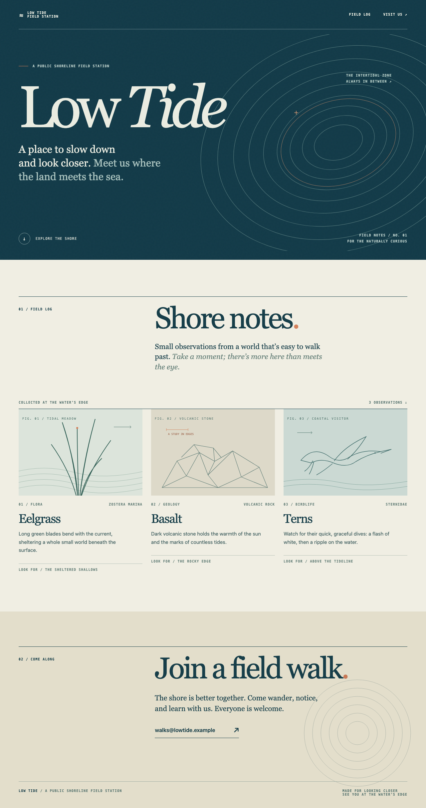
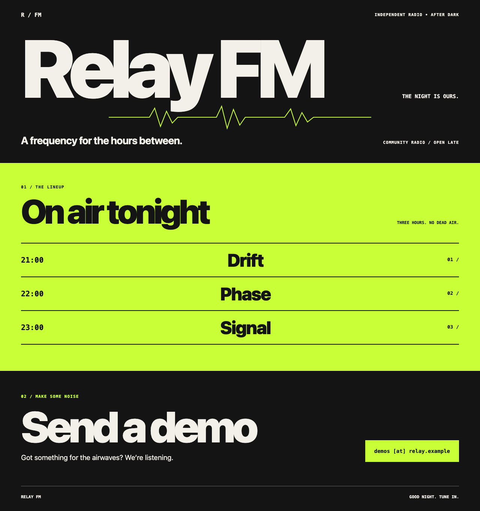
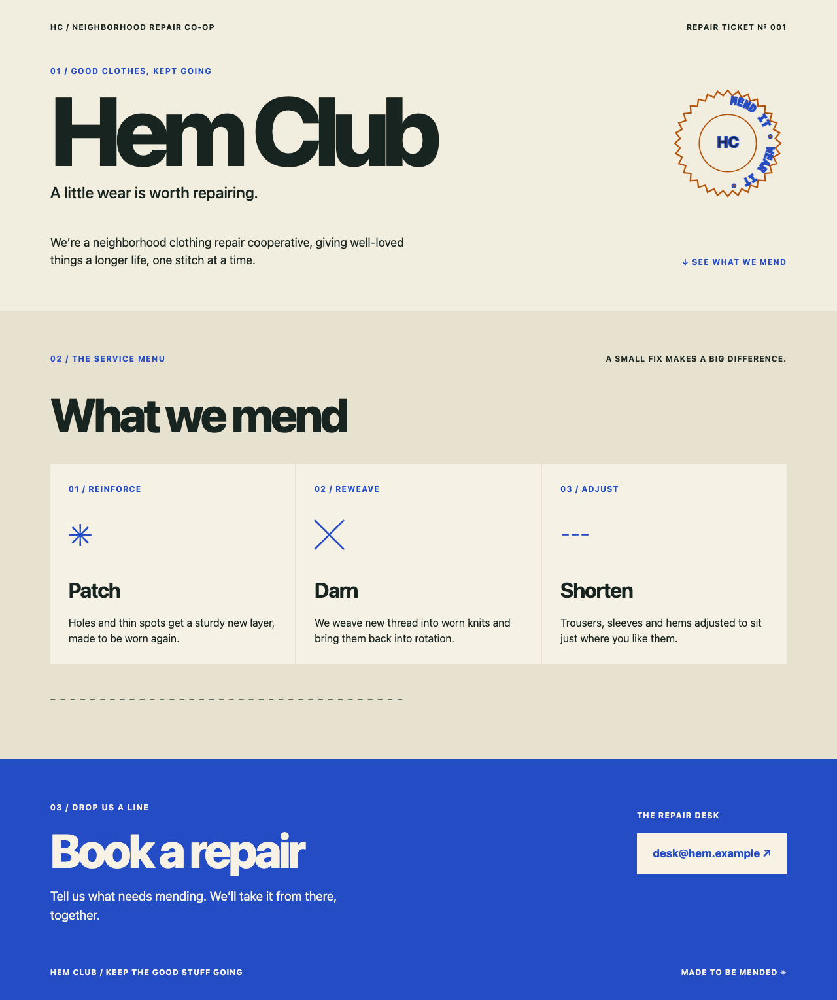
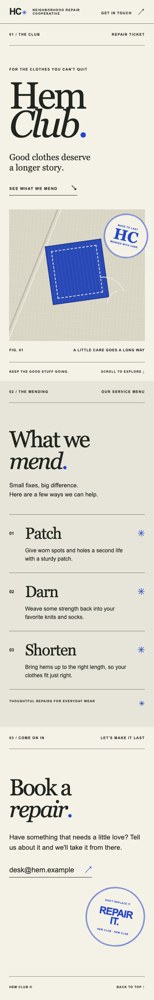
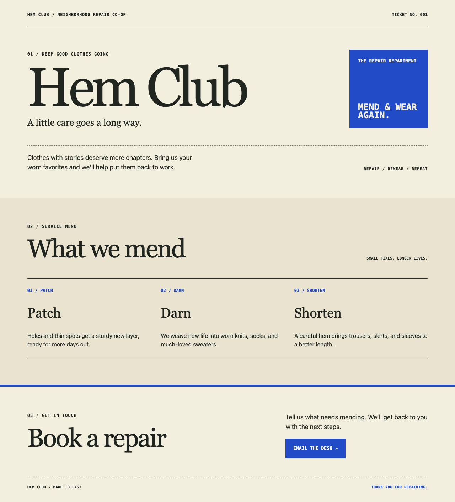
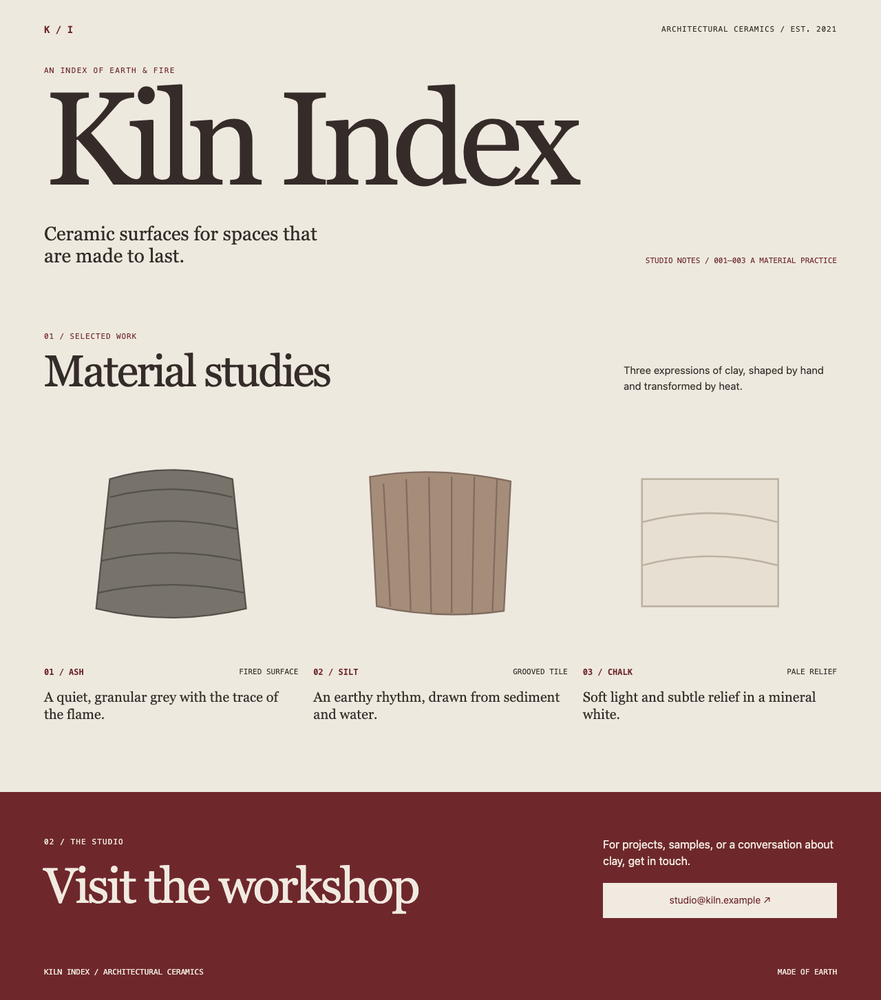
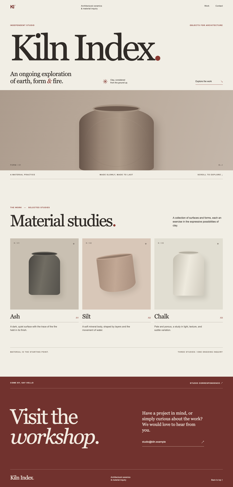

# Culm and Astro, side by side

[Back to Culm](../../README.md) · [All scores](#scores-for-every-pair) · [Tokens, cost and speed](#tokens-cost-and-speed) · [Method](#how-to-read-this-comparison)

What does the same agent build when you give it the same brief but a different framework? We compared Culm's JSON authoring tools with Astro 7.4.13 and ordinary CSS. Each got two independent attempts at each of four briefs. **Every site passed the functional checks; none was repaired by hand.**

## Screenshot gallery

These are the final browser captures, at **1280px desktop** and **390px phone**. Click a screenshot to inspect it at its original resolution. Culm is always on the left on this page; labels were randomized for judging.

### Low Tide · shoreline field station

The brief called for a field notebook with tide contours and observations about eelgrass, basalt and terns. Both Culm runs used the new `contours` scene shorthand for a dark marine-blue intertidal contour hero map and distinct procedural contour studies above Eelgrass, Basalt and Terns; both Astro runs drew custom annotated botanical and geological SVG plates beside a radial contour hero. In blind judging (`18 / 19` in both runs), `gpt-6.2-astra` rated Culm `5/5` on hierarchy and mobile composition while preferring Astro's recognizable figurative sketches (`5/5` brief fit vs `4/5`).

| Culm · run 1 · desktop                                                                                                                                                     | Astro · run 1 · desktop                                                                                                                                       |
| -------------------------------------------------------------------------------------------------------------------------------------------------------------------------- | ------------------------------------------------------------------------------------------------------------------------------------------------------------- |
|  |  |

Run 1 on phones · Culm 18 / Astro 19

| Culm · phone                                                                                                                     | Astro · phone                                                                                                                       |
| -------------------------------------------------------------------------------------------------------------------------------- | ----------------------------------------------------------------------------------------------------------------------------------- |
|  |  |

Run 2 · Culm 18 / Astro 19

| Culm                                                                                                                                 | Astro                                                                                                                                   |
| ------------------------------------------------------------------------------------------------------------------------------------ | --------------------------------------------------------------------------------------------------------------------------------------- |
|  |  |
|        |        |

### Relay FM · late-night radio station

The challenge was to make a gig poster that still works as a timetable. Both Culm runs built sinusoidal waveforms with Culm's `wave`/`scene` marks (plus a serrated community-radio `stamp` seal in run 2) above a bold acid-lime schedule; both Astro runs paired oversized stacked headings with a lime timetable and demo section. Run 2 tied at **19/20**: `gpt-6.2-astra` rated Culm higher on mobile composition (`5` vs `4`) while docking typography slightly (`4` vs `5`) for tight word spacing on display headings (`"On air tonight"`).

Run 1 · Culm 17 / Astro 20

| Culm                                                                                                                                             | Astro                                                                                                                                             |
| ------------------------------------------------------------------------------------------------------------------------------------------------ | ------------------------------------------------------------------------------------------------------------------------------------------------- |
|  |  |
|                          |                        |

Run 2 · Culm 19 / Astro 19

| Culm                                                                                                                                                     | Astro                                                                                                                                                   |
| -------------------------------------------------------------------------------------------------------------------------------------------------------- | ------------------------------------------------------------------------------------------------------------------------------------------------------- |
|  |  |
|                                    |                                |

### Hem Club · clothing repair cooperative

The brief asked for a printed repair ticket. Both Culm runs used the new `stamp` emblem alongside custom cobalt stitch marks (`Patch`, `Darn`, `Shorten`), perforated rules and a cobalt footer band; Astro drew stitched fabric patches with circular blue stamps. Both runs scored `18 / 20` vs `20 / 20` (run 1) and `18 / 20` vs `19 / 20` (run 2): the judge praised Culm's typography and service legibility while noting smaller phone stamp lettering in run 1 and an orange stamp in run 2 instead of cobalt.

Run 1 · Culm 18 / Astro 20

| Culm                                                                                                                                                   | Astro                                                                                                                                                                    |
| ------------------------------------------------------------------------------------------------------------------------------------------------------ | ------------------------------------------------------------------------------------------------------------------------------------------------------------------------ |
|  |  |
|                             |                                            |

Run 2 · Culm 18 / Astro 19

| Culm                                                                                                                                                            | Astro                                                                                                                                                            |
| --------------------------------------------------------------------------------------------------------------------------------------------------------------- | ---------------------------------------------------------------------------------------------------------------------------------------------------------------- |
|  |  |
|                       |                           |

### Kiln Index · architectural ceramics studio

Both frameworks had to show three material studies on warm paper with oxblood details. Run 2 tied at **19/20** (Culm scored `5/5` on hierarchy, typography and mobile composition), while in run 1 literal `\n` characters inside Culm's authored strings and low contrast on the pale Chalk figure pulled it to `16/20` against Astro's `20/20`.

Run 1 · Culm 16 / Astro 20

| Culm                                                                                                                                                                               | Astro                                                                                                                                                                       |
| ---------------------------------------------------------------------------------------------------------------------------------------------------------------------------------- | --------------------------------------------------------------------------------------------------------------------------------------------------------------------------- |
|  |  |
|                                              |                                    |

Run 2 · Culm 19 / Astro 19

| Culm                                                                                                                                                       | Astro                                                                                                                                                              |
| ---------------------------------------------------------------------------------------------------------------------------------------------------------- | ------------------------------------------------------------------------------------------------------------------------------------------------------------------ |
|  |  |
|                       |                                  |

## Scores for every pair

Each cell is **Culm / Astro**, out of 20. A score covers both screenshots of the site.

| Brief      |   Run 1 |   Run 2 |
| ---------- | ------: | ------: |
| Low Tide   | 18 / 19 | 18 / 19 |
| Relay FM   | 17 / 20 | 19 / 19 |
| Hem Club   | 18 / 20 | 18 / 19 |
| Kiln Index | 16 / 20 | 19 / 19 |

Culm won **0**, tied **2** and lost **6**, with mean score **`17.875/20` vs. Astro's `19.375/20`**. On individual rubric criteria (`1–5`), Culm averaged **`4.38`** brief fit, **`4.88`** hierarchy, **`4.13`** typography and **`4.50`** phone composition, compared with Astro's **`5.00`** brief fit, **`5.00`** hierarchy, **`4.88`** typography and **`4.50`** phone composition.

## Tokens, cost and speed

| Builder metric                   |      Culm |     Astro |
| -------------------------------- | --------: | --------: |
| Functional passes                |       8/8 |       8/8 |
| Total input tokens               | 1,034,738 | 1,187,083 |
| ↳ Fresh input                    |    94,194 |   133,003 |
| ↳ Cached reads                   |   940,544 | 1,054,080 |
| Total output tokens              |    27,669 |    43,409 |
| Estimated total cost             |   $0.2795 |   $0.4027 |
| Estimated cost per accepted site |   $0.0349 |   $0.0503 |
| Median agent session             |    68.3 s |   122.0 s |

The token counts come from all 16 static builder sessions (`8` per arm, `codex-cli 0.171.0`, `gpt-6.1-terra`, low reasoning). Culm used **36.3% fewer output tokens** and **12.8% fewer total input tokens**, finishing in **44.0% less median wall time** (`68.3 s` vs `122.0 s`). Prices use the same rate card per million tokens: $1 for fresh input, $0.05 for cached reads, $1.25 for cache writes (none recorded), and $5 for output. If all input were priced as fresh, holding token counts fixed, the estimates would be **$0.1466/site for Culm and $0.1755 for Astro**.

| Exported-site metric                   |     Culm |    Astro |
| -------------------------------------- | -------: | -------: |
| Static CLI export                      |  0.220 s |  0.439 s |
| Desktop largest contentful paint (LCP) |    24 ms |    38 ms |
| Throttled-phone LCP                    |   214 ms |   424 ms |
| Throttled-phone load event             | 216.8 ms | 342.2 ms |
| Compressed transfer                    | 3.99 KiB | 3.72 KiB |
| Requests per navigation                |        1 |        2 |

Export timing covers CLI startup through writing the static files, with dependencies installed. Each of the 16 sites was exported three times. For visitor timing, each site received three cold Chromium navigations at each viewport (96 total), over local HTTP with Brotli compression. The phone profile used 4× CPU slowdown, 150ms latency and 1.6 Mbit/s download; desktop was unthrottled. The table gives the median of the per-site medians. Culm transferred slightly more bytes but used one request instead of two. These are lab results for these pages, not field measurements.

## How to read this comparison

- **Same assignment, different tools.** Each independent builder was `gpt-6.1-terra` at low reasoning effort in Codex CLI `0.171.0`, with a four-minute limit. Each began with a blank home page, the same required copy and mail link, three ordered sections, system fonts and local artwork. Culm builders used the JSON MCP tools; Astro builders edited local Astro and CSS files. Two builders ran concurrently, in randomized order.
- **Function and appearance were checked separately.** Chromium verified required visible copy, the working mail link, no horizontal scrolling, no blocked requests and no browser errors at both widths. For design, a fresh `gpt-6.2-astra` judge per brief/run received the brief and randomly labeled desktop/phone screenshots. It scored brief fit, hierarchy, typography and phone composition from 1 to 5. Judging included two additional Culm development configurations; this page reports only the shipping workflow and Astro from that same round.
- **What was verified on `main`.** The builders and timings are from the recorded trial. Replaying all eight Culm edit histories against [the public release](https://github.com/Culmjs/core/commit/80289192b02b8aaa851cb754c5472ccd7c757d84) produced identical documents and static HTML. The gallery uses the original desktop and phone captures, encoded losslessly. Eight matched pairs on four short briefs are useful evidence, not a general framework ranking.

## Post-remediation & Stage 3 Motion benchmark (Culm vs. Astro & GSAP 3.15.1)

A follow-up live benchmark ran 16 sessions (`codex-cli 0.171.0`, `gpt-6.1-terra`, low reasoning, isolated `CODEX_HOME` with host skills disabled) comparing compact Culm MCP vs. Astro 7.4.13 on static briefs and **Culm Stage 3 Motion** vs. **Astro + GSAP 3.15.1 (`ScrollTrigger`)** on animated/scroll-choreography briefs, alongside a controlled Chromium `156.0.8078.4` engine microbenchmark.

### All 16 Live Builder Sessions

| Cohort | Brief       | Arm            | Functional | Motion + JS-off + RM | Wall (s) |     Input (`Fresh` / `Cached`) | Output | Cost (Base / Uncached / Frontier) | CLI Build |    Raw JS |  Brotli (Reqs) | Desk LCP / Mob LCP | Mob Load |
| ------ | ----------- | -------------- | ---------- | -------------------- | -------: | -----------------------------: | -----: | --------------------------------- | --------: | --------: | -------------: | -----------------: | -------: |
| Static | `studio`    | **Culm**       | Pass       | —                    |    46.45 |  111,942 (`13,894` / `98,048`) |  1,980 | `$0.0287` / `$0.1218` / `$0.0790` |   0.218 s |     581 B |  3,601 B (`1`) |        24 / 212 ms | 206.5 ms |
| Static | `studio`    | **Astro**      | Pass       | —                    |   122.68 | 152,326 (`28,550` / `123,776`) |  5,715 | `$0.0633` / `$0.1809` / `$0.1595` |   0.431 s |       0 B |  3,787 B (`2`) |        28 / 392 ms | 343.2 ms |
| Static | `music`     | **Culm**       | Pass       | —                    |    72.32 |   94,984 (`13,448` / `81,536`) |  3,223 | `$0.0336` / `$0.1111` / `$0.0862` |   0.202 s |     581 B |  3,923 B (`1`) |        24 / 216 ms | 211.5 ms |
| Static | `music`     | **Astro**      | Pass       | —                    |   116.91 | 179,398 (`22,470` / `156,928`) |  4,473 | `$0.0527` / `$0.2018` / `$0.1401` |   0.397 s |       0 B |  2,797 B (`2`) |        40 / 452 ms | 341.9 ms |
| Static | `repair`    | **Culm**       | Pass       | —                    |    64.27 | 153,817 (`15,065` / `138,752`) |  2,495 | `$0.0345` / `$0.1663` / `$0.0973` |   0.222 s |     581 B |  4,038 B (`1`) |        32 / 244 ms | 237.8 ms |
| Static | `repair`    | **Astro**      | Pass       | —                    |   112.59 |  142,095 (`9,487` / `132,608`) |  5,058 | `$0.0414` / `$0.1674` / `$0.1074` |   0.451 s |       0 B |  3,819 B (`2`) |        40 / 440 ms | 334.3 ms |
| Static | `tide`      | **Culm**       | Pass       | —                    |   117.73 | 122,848 (`10,592` / `112,256`) |  5,664 | `$0.0445` / `$0.1512` / `$0.1112` |   0.228 s |     581 B | 10,094 B (`1`) |        24 / 212 ms | 216.4 ms |
| Static | `tide`      | **Astro**      | Pass       | —                    |   129.44 | 138,805 (`16,437` / `122,368`) |  5,978 | `$0.0524` / `$0.1687` / `$0.1315` |   0.457 s |       0 B |  4,628 B (`2`) |        44 / 412 ms | 342.4 ms |
| Motion | `traverse`  | **Culm**       | Pass       | Pass                 |    73.67 | 120,583 (`11,911` / `108,672`) |  2,784 | `$0.0313` / `$0.1345` / `$0.0848` |   0.217 s |   8,768 B |  8,243 B (`1`) |        28 / 224 ms | 226.1 ms |
| Motion | `traverse`  | **Astro+GSAP** | Pass       | Pass                 |   120.34 | 123,056 (`13,360` / `109,696`) |  5,860 | `$0.0481` / `$0.1524` / `$0.1194` |   0.409 s | 113,656 B | 47,499 B (`3`) |        40 / 452 ms | 583.4 ms |
| Motion | `waterline` | **Culm**       | Pass       | Pass                 |    52.85 |   75,934 (`16,926` / `59,008`) |  2,034 | `$0.0300` / `$0.0861` / `$0.0774` |   0.222 s |   8,768 B |  7,709 B (`1`) |        24 / 212 ms | 219.1 ms |
| Motion | `waterline` | **Astro+GSAP** | Pass       | Pass                 |   106.67 |   102,345 (`3,529` / `98,816`) |  5,018 | `$0.0336` / `$0.1274` / `$0.0837` |   0.429 s | 113,538 B | 46,952 B (`3`) |        36 / 436 ms | 591.1 ms |
| Motion | `ledger`    | **Culm**       | Pass       | Pass                 |    68.58 |    78,271 (`9,151` / `69,120`) |  3,115 | `$0.0282` / `$0.0938` / `$0.0713` |   0.222 s |   8,768 B |  8,960 B (`1`) |        32 / 208 ms | 240.6 ms |
| Motion | `ledger`    | **Astro+GSAP** | Pass       | Pass                 |   125.71 |  127,088 (`6,000` / `121,088`) |  6,186 | `$0.0430` / `$0.1580` / `$0.1071` |   0.426 s | 113,891 B | 47,917 B (`3`) |        36 / 444 ms | 585.9 ms |
| Motion | `atelier`   | **Culm**       | Pass       | Pass                 |    98.85 |  100,750 (`11,022` / `89,728`) |  4,756 | `$0.0393` / `$0.1245` / `$0.0975` |   0.212 s |   8,768 B |  8,065 B (`1`) |        24 / 224 ms | 223.6 ms |
| Motion | `atelier`   | **Astro+GSAP** | Pass       | Fail                 |   109.29 |    49,771 (`4,203` / `45,568`) |  5,521 | `$0.0341` / `$0.0774` / `$0.0771` |   0.415 s | 113,867 B | 47,574 B (`3`) |        40 / 440 ms | 590.1 ms |

### Controlled Motion Engine Benchmark (Culm Stage 3 vs. GSAP 3.15.1 + ScrollTrigger)

| Scene    | Engine / Tier                  | Raw HTML / CSS / JS         |    Brotli (Reqs) | Desk Load / Cold JS | Mob Load / Cold JS | Sweep Script (Desk / Mob) | Sweep Layout (Desk / Mob) |   Heap (Desk / Mob) |
| -------- | ------------------------------ | --------------------------- | ---------------: | ------------------: | -----------------: | ------------------------: | ------------------------: | ------------------: |
| `native` | **Culm** (Tier-1 CSS `view()`) | `6,883 / 5,888 / 304 B`     |  `2,282 B` (`1`) |     `9.9 / 0.13 ms` |  `204.6 / 0.72 ms` |          `1.53 / 1.00 ms` |          `0.00 / 0.00 ms` | `1,075 / 1,075 KiB` |
| `native` | **GSAP 3.15.1 + ST**           | `2,588 / 1,613 / 118,275 B` | `46,443 B` (`3`) |    `22.2 / 4.80 ms` | `575.0 / 19.45 ms` |          `8.88 / 8.92 ms` |          `0.29 / 0.13 ms` | `1,826 / 1,827 KiB` |
| `box`    | **Culm** (Tier-2 Host)         | `15,841 / 5,826 / 8,490 B`  |  `6,675 B` (`1`) |    `10.9 / 1.36 ms` |  `212.5 / 4.21 ms` |          `0.72 / 1.26 ms` |          `0.05 / 0.04 ms` | `1,223 / 1,223 KiB` |
| `box`    | **GSAP 3.15.1 + ST**           | `2,856 / 1,613 / 118,254 B` | `46,569 B` (`3`) |    `20.2 / 4.58 ms` | `571.4 / 16.97 ms` |          `5.81 / 5.79 ms` |          `0.00 / 0.00 ms` | `1,811 / 1,824 KiB` |
| `panel`  | **Culm** (Tier-2 Host)         | `16,336 / 5,961 / 8,490 B`  |  `6,665 B` (`1`) |    `17.3 / 1.71 ms` |  `216.1 / 6.39 ms` |          `5.33 / 2.79 ms` |          `0.00 / 0.00 ms` | `1,330 / 1,329 KiB` |
| `panel`  | **GSAP 3.15.1 + ST**           | `2,732 / 1,613 / 118,272 B` | `46,495 B` (`3`) |    `21.9 / 6.20 ms` | `593.3 / 27.72 ms` |          `7.84 / 8.84 ms` |          `0.36 / 0.95 ms` | `1,951 / 1,946 KiB` |
| `type`   | **Culm** (Tier-2 Host)         | `15,968 / 5,946 / 8,490 B`  |  `6,667 B` (`1`) |    `14.5 / 0.89 ms` |  `210.0 / 3.65 ms` |         `6.15 / 20.62 ms` |          `0.19 / 0.81 ms` | `1,299 / 1,299 KiB` |
| `type`   | **GSAP 3.15.1 + ST**           | `2,939 / 1,613 / 118,626 B` | `46,598 B` (`3`) |    `20.9 / 5.39 ms` | `574.2 / 20.45 ms` |         `10.73 / 6.34 ms` |          `0.00 / 0.00 ms` | `2,345 / 2,344 KiB` |
