# Culm and Astro, side by side

[Back to Culm](../../README.md) · [All scores](#scores-for-every-pair) · [Tokens, cost and speed](#tokens-cost-and-speed) · [Method](#how-to-read-this-comparison)

What does the same agent build when you give it the same brief but a different framework? We compared Culm's JSON authoring tools with Astro 7.4.13 and ordinary CSS. Each got two independent attempts at each of four briefs. **Every site passed the functional checks; none was repaired by hand.**

## Screenshot gallery

These are the final browser captures, at **1280px desktop** and **390px phone**. Click a screenshot to inspect it at its original resolution. Culm is always on the left on this page; labels were randomized for judging.

### Low Tide · shoreline field station

The brief called for a field notebook with tide contours and observations about eelgrass, basalt and terns. This was the one brief not used to develop the authoring changes. The first pair **tied at 19/20**: Culm put fine contour lines under a dark masthead; Astro put an annotated chart beside the title on a sand-colored page.

| Culm · run 1 · desktop                                                                                                                                 | Astro · run 1 · desktop                                                                                                                                |
| ------------------------------------------------------------------------------------------------------------------------------------------------------ | ------------------------------------------------------------------------------------------------------------------------------------------------------ |
| [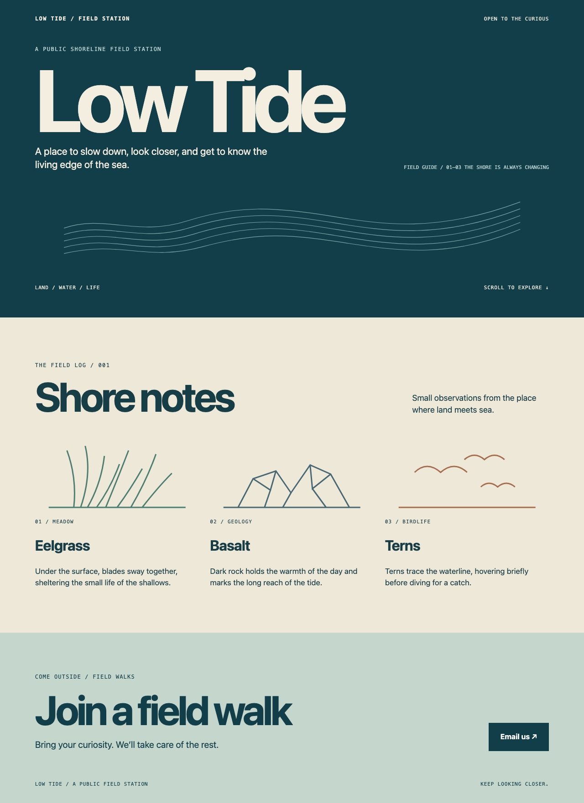](screenshots/low-tide-1-culm-desktop.webp) |  |

Run 1 on phones · Culm 19 / Astro 19

| Culm · phone                                                                                                                     | Astro · phone                                                                                                                       |
| -------------------------------------------------------------------------------------------------------------------------------- | ----------------------------------------------------------------------------------------------------------------------------------- |
|  |  |

Run 2 · Culm 20 / Astro 19

| Culm                                                                                                                                 | Astro                                                                                                                                   |
| ------------------------------------------------------------------------------------------------------------------------------------ | --------------------------------------------------------------------------------------------------------------------------------------- |
| [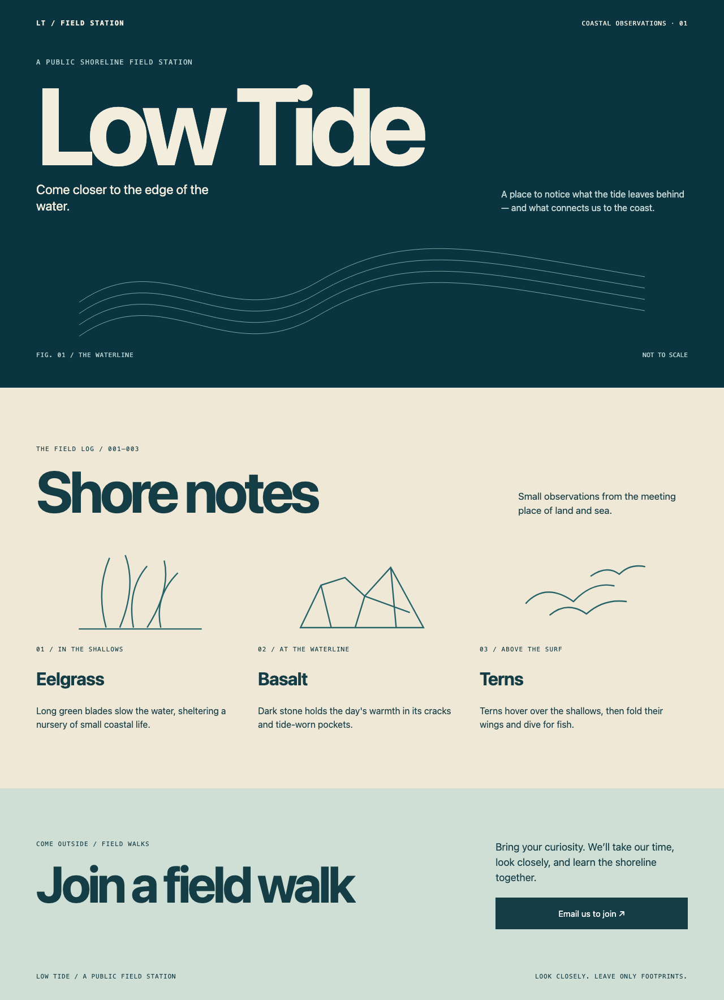](screenshots/low-tide-2-culm-desktop.webp) | [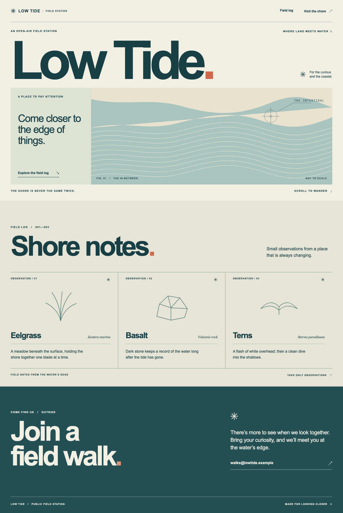](screenshots/low-tide-2-astro-desktop.webp) |
|        | [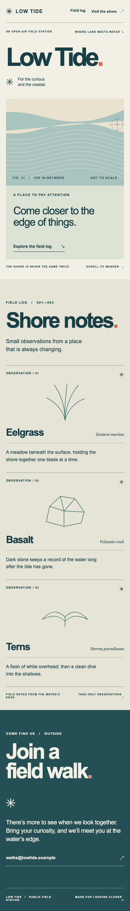](screenshots/low-tide-2-astro-phone.webp)       |

### Relay FM · late-night radio station

The challenge was to make a gig poster that still works as a timetable. Both Culm runs used waveforms and a lime schedule; both Astro runs paired a stacked wordmark with a record. In run 1 the judge preferred Astro’s type treatment and noted that the descender in Culm’s “Relay” obscured part of the desktop tagline.

Run 1 · Culm 17 / Astro 20

| Culm                                                                                                                                        | Astro                                                                                                                                        |
| ------------------------------------------------------------------------------------------------------------------------------------------- | -------------------------------------------------------------------------------------------------------------------------------------------- |
|  | [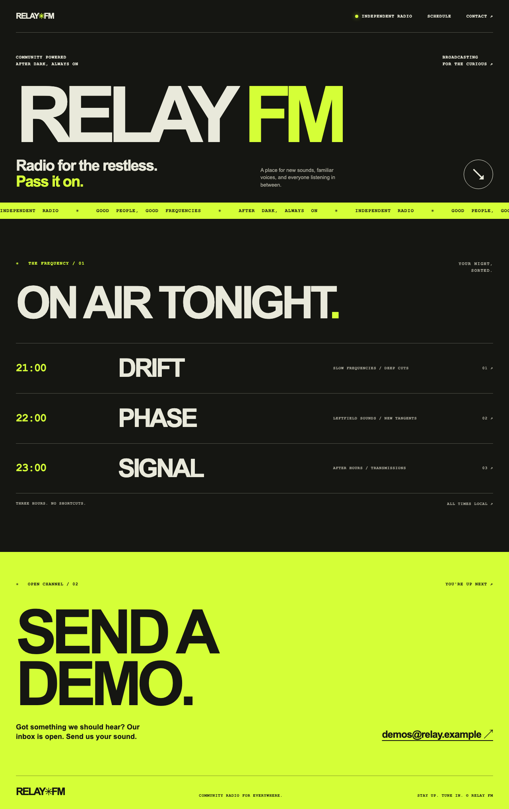](screenshots/relay-fm-1-astro-desktop.webp) |
|                     |                   |

Run 2 · Culm 18 / Astro 19

| Culm                                                                                                                                              | Astro                                                                                                                                                    |
| ------------------------------------------------------------------------------------------------------------------------------------------------- | -------------------------------------------------------------------------------------------------------------------------------------------------------- |
|  |  |
| [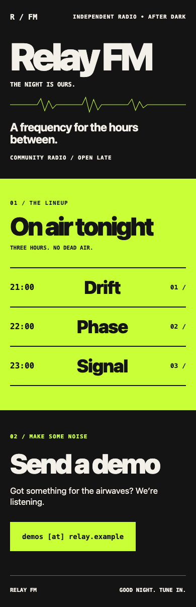](screenshots/relay-fm-2-culm-phone.webp)                            |                                 |

### Hem Club · clothing repair cooperative

The brief asked for a printed repair ticket. The two runs went different ways: Astro’s cobalt patch and stamp won the first; Culm’s serif headings, ticket numbers and full-width phone service entries won the second.

Run 1 · Culm 16 / Astro 20

| Culm                                                                                                                               | Astro                                                                                                                                                              |
| ---------------------------------------------------------------------------------------------------------------------------------- | ------------------------------------------------------------------------------------------------------------------------------------------------------------------ |
|  | [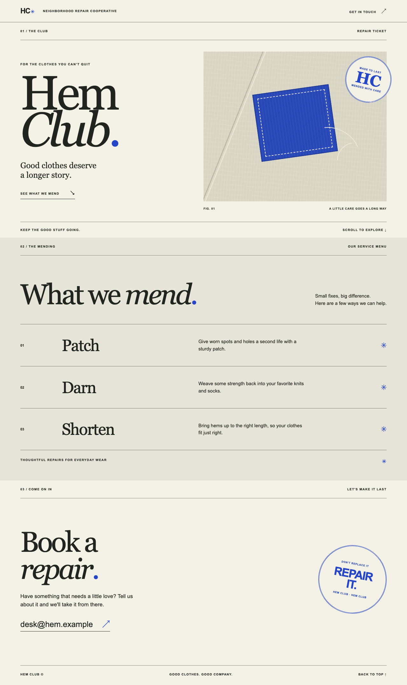](screenshots/hem-club-1-astro-desktop.webp) |
|         |                                      |

Run 2 · Culm 20 / Astro 18

| Culm                                                                                                                                                           | Astro                                                                                                                                                   |
| -------------------------------------------------------------------------------------------------------------------------------------------------------------- | ------------------------------------------------------------------------------------------------------------------------------------------------------- |
|  | [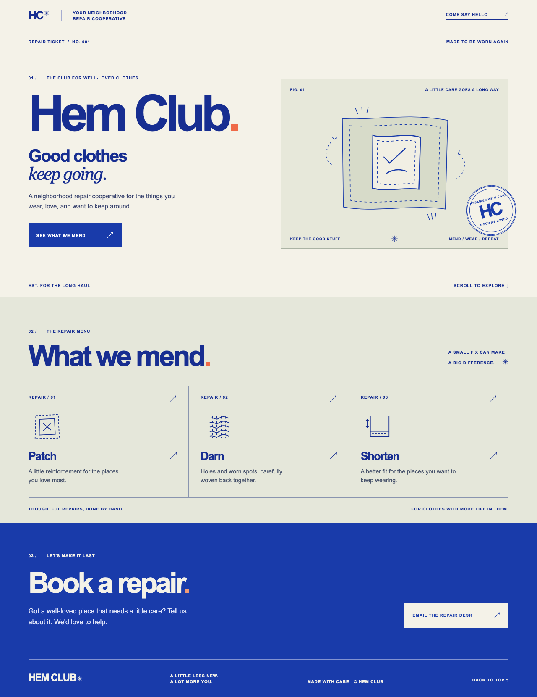](screenshots/hem-club-2-astro-desktop.webp) |
|                      |                  |

### Kiln Index · architectural ceramics studio

Both frameworks had to show three material studies without external images. Compare the treatments of Ash, Silt and Chalk: the judge favored Astro’s captioned relief studies in run 1, and Culm’s distinct curved bands, grooves and shallow relief in run 2.

Run 1 · Culm 18 / Astro 19

| Culm                                                                                                                                                           | Astro                                                                                                                                                          |
| -------------------------------------------------------------------------------------------------------------------------------------------------------------- | -------------------------------------------------------------------------------------------------------------------------------------------------------------- |
| [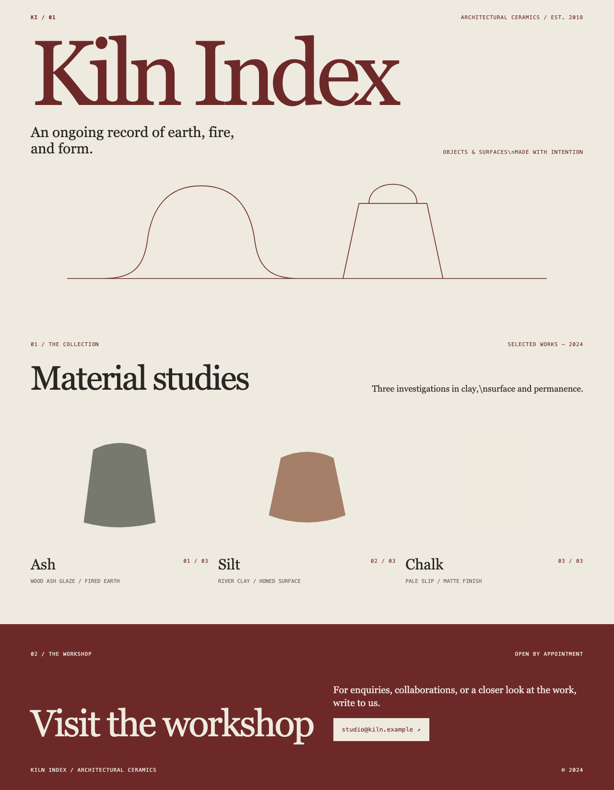](screenshots/kiln-index-1-culm-desktop.webp) | [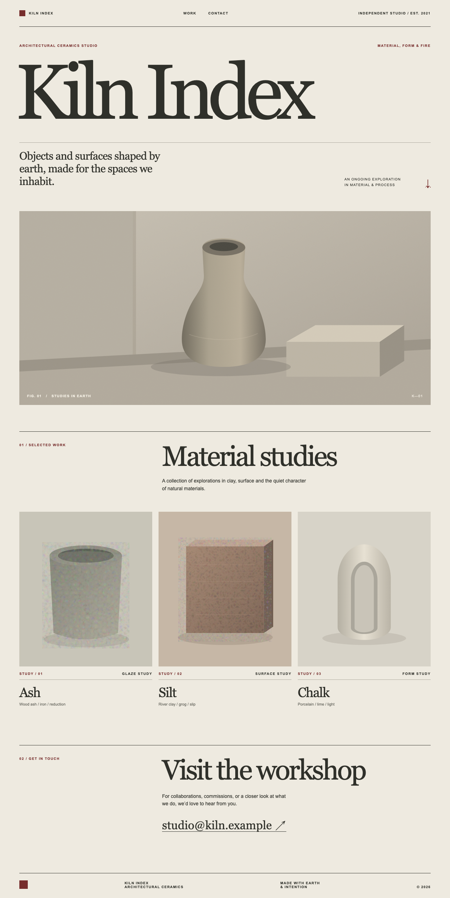](screenshots/kiln-index-1-astro-desktop.webp) |
|                          | [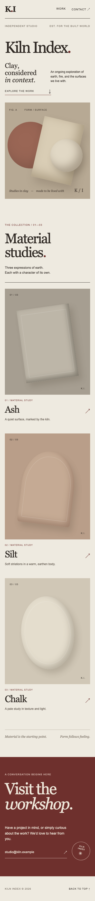](screenshots/kiln-index-1-astro-phone.webp)                      |

Run 2 · Culm 20 / Astro 19

| Culm                                                                                                                                                     | Astro                                                                                                                                                              |
| -------------------------------------------------------------------------------------------------------------------------------------------------------- | ------------------------------------------------------------------------------------------------------------------------------------------------------------------ |
|  |  |
|                     |                                  |

## Scores for every pair

Each cell is **Culm / Astro**, out of 20. A score covers both screenshots of the site.

| Brief      |   Run 1 |   Run 2 |
| ---------- | ------: | ------: |
| Low Tide   | 19 / 19 | 20 / 19 |
| Relay FM   | 17 / 20 | 18 / 19 |
| Hem Club   | 16 / 20 | 20 / 18 |
| Kiln Index | 18 / 19 | 20 / 19 |

Culm won **3**, tied **1** and lost **4**. The judge rated brief fit equally (4.75/5 each) and preferred Culm’s phone composition on average (4.75 vs 4.375). Astro led on typography (5.00 vs 4.25) and visual hierarchy (5.00 vs 4.75). The trial’s target of matching Astro’s mean visual score was not met.

## Tokens, cost and speed

| Builder metric                   |      Culm |   Astro |
| -------------------------------- | --------: | ------: |
| Functional passes                |       8/8 |     8/8 |
| Total input tokens               | 1,077,837 | 902,118 |
| ↳ Fresh input                    |    63,437 | 149,606 |
| ↳ Cached reads                   | 1,014,400 | 752,512 |
| Total output tokens              |    18,988 |  33,803 |
| Estimated total cost             |   $0.2091 | $0.3562 |
| Estimated cost per accepted site |   $0.0261 | $0.0445 |
| Median agent session             |    53.5 s |  84.5 s |

The token counts come from the builder sessions, including prompt history and tool traffic. Culm used **43.8% fewer output tokens** and **19.5% more total input tokens**. Prices are estimates, not invoices: per million tokens the trial used $1 for fresh input, $0.05 for cached reads, $1.25 for cache writes (none recorded), and $5 for output. If all input were priced as fresh, holding token counts fixed, the estimates would be **$0.1466/site for Culm and $0.1339 for Astro**. Builder time and cost exclude setup, independent verification and judging.

| Exported-site metric                   |     Culm |    Astro |
| -------------------------------------- | -------: | -------: |
| Static CLI export                      |  0.191 s |  1.385 s |
| Desktop largest contentful paint (LCP) |    20 ms |    32 ms |
| Throttled-phone LCP                    |   214 ms |   428 ms |
| Throttled-phone load event             | 211.5 ms | 344.8 ms |
| Compressed transfer                    | 3.62 KiB | 3.35 KiB |
| Requests per navigation                |        1 |        2 |

Export timing covers CLI startup through writing the static files, with dependencies installed. Each of the 16 sites was exported three times. For visitor timing, each site received three cold Chromium navigations at each viewport (96 total), over local HTTP with Brotli compression. The phone profile used 4× CPU slowdown, 150ms latency and 1.6 Mbit/s download; desktop was unthrottled. The table gives the median of the per-site medians. Culm transferred slightly more bytes but used one request instead of two. These are lab results for these pages, not field measurements.

## How to read this comparison

- **Same assignment, different tools.** Each independent builder was `gpt-6.1-terra` at low reasoning effort in Codex CLI `0.171.0`, with a four-minute limit. Each began with a blank home page, the same required copy and mail link, three ordered sections, system fonts and local artwork. Culm builders used the JSON MCP tools; Astro builders edited local Astro and CSS files. Two builders ran concurrently, in randomized order.
- **Function and appearance were checked separately.** Chromium verified required visible copy, the working mail link, no horizontal scrolling, no blocked requests and no browser errors at both widths. For design, a fresh `gpt-6.2-astra` judge per brief/run received the brief and randomly labeled desktop/phone screenshots. It scored brief fit, hierarchy, typography and phone composition from 1 to 5. Judging included two additional Culm development configurations; this page reports only the shipping workflow and Astro from that same round.
- **What was verified on `main`.** The builders and timings are from the recorded trial. Replaying all eight Culm edit histories against [the public release](https://github.com/Culmjs/core/commit/80289192b02b8aaa851cb754c5472ccd7c757d84) produced identical documents and static HTML. The gallery uses the original desktop and phone captures, encoded losslessly. Eight matched pairs on four short briefs are useful evidence, not a general framework ranking.
